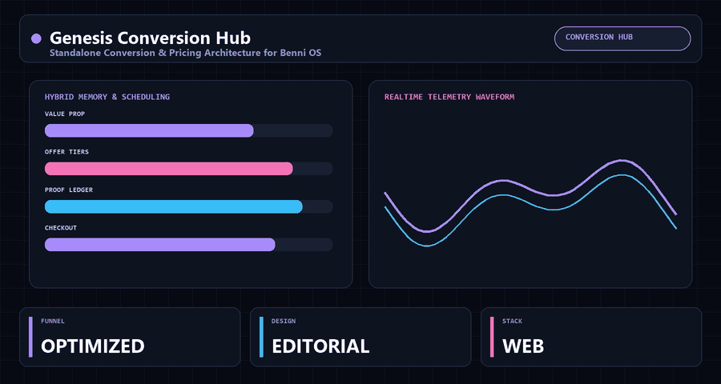

 

 

> **Standalone Conversion & Pricing Architecture for Benni OS.**  
> Part of the **Benni Master OS** sovereign engineering ecosystem.

 

---

## ⚡ Overview

**Genesis Conversion Hub** — Standalone Conversion & Pricing Architecture for Benni OS.

### Architecture Highlights
- **Nodes:** VALUE PROP · OFFER TIERS · PROOF LEDGER · CHECKOUT
- **Ecosystem:** Native integration with **Benni Master OS** (`benni-os.net`).
